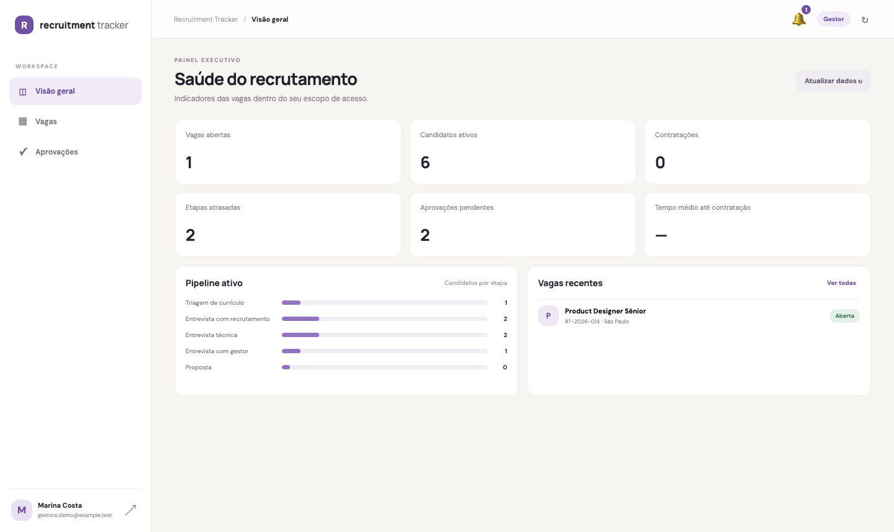
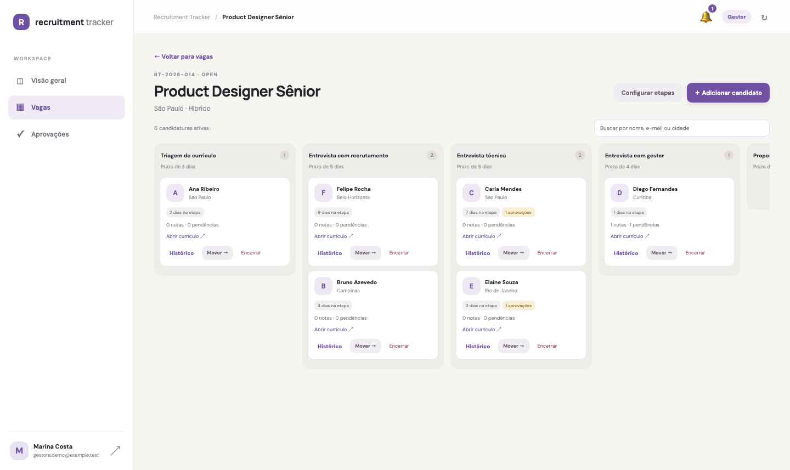
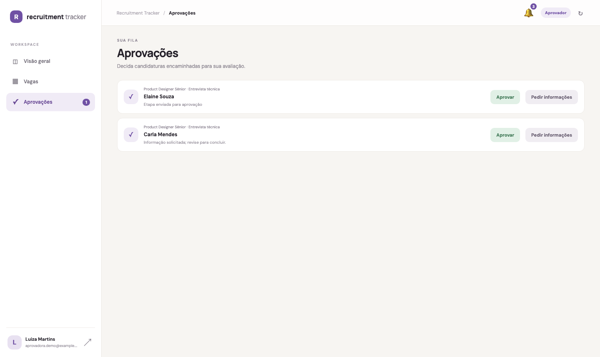

# Recruitment Tracker

Plataforma de recrutamento com painel web em React/TypeScript usando o tema e componentes do [CoreUI Free React Admin Template](https://github.com/coreui/coreui-free-react-admin-template), aplicativo móvel React Native, API REST em Node.js e PostgreSQL. O template CoreUI e seus componentes React são distribuídos sob licença MIT.

## Visão do aplicativo

As telas abaixo são capturas reais do painel web conectado à API e ao PostgreSQL, preenchido com candidatos fictícios para demonstração.

| Painel executivo | Pipeline Kanban |
| --- | --- |
|  |  |

| Aprovações pendentes |
| --- |
|  |

## Funcionalidades disponíveis

- Login Google e papéis de administrador, gestora, recrutador e aprovador.
- Cadastro e gestão de vagas e departamentos.
- Etapas por vaga, prazos, aprovadores e regras de transição.
- Candidatos e candidaturas independentes por vaga, com busca de duplicidade.
- Board Kanban, movimentação validada, histórico e tempos por etapa.
- Aprovações, observações, atividades, contratação, reprovação e desistência.
- Caixa de notificações para aprovações pendentes, com leitura por usuário.
- Dashboard com vagas, candidaturas ativas, contratações, aprovações e atrasos.
- Aplicativo Android/iOS conectado à mesma API.

## Integração contínua

O [GitHub Actions](.github/workflows/ci.yml) roda em pushes para `main` e `projeto-inicial`, pull requests para `main` e também pode ser iniciado manualmente. O pipeline instala as dependências, verifica a sintaxe dos scripts da API, compila o painel web e valida a configuração do Docker Compose. A validação do Compose usa valores fictícios de CI e não requer credenciais reais.

## Arquitetura e modelo de dados

Os diagramas Mermaid de implantação, modelo relacional, autenticação e fluxos principais, além dos limites da arquitetura atual, estão em [docs/architecture.md](docs/architecture.md). As migrations PostgreSQL executáveis estão em `apps/api/migrations`; `prisma/schema.prisma` é um modelo de referência e não é aplicado pelo Compose.

## Subir a plataforma com Docker

Requer Docker Desktop com Docker Compose.

```sh
cp -n .env.example .env
```

Edite `.env` (se ele já existir, preserve-o e ajuste os valores necessários): informe o client ID OAuth Web em `GOOGLE_CLIENT_ID`, o e-mail fixo do administrador em `INITIAL_ADMIN_EMAIL` e troque `SESSION_SECRET` por uma string aleatória com ao menos 32 caracteres. O Compose usa automaticamente esse mesmo client ID no frontend e na validação de audiência da API; IDs OAuth adicionais podem ser listados em `GOOGLE_EXTRA_CLIENT_IDS`, separados por vírgula. Para o Compose, `DATABASE_URL` usa o host `postgres` (não `localhost`). O Compose inicia PostgreSQL, aplica migrations, inicia a API e serve o painel pelo Nginx.

```sh
docker compose up --build -d
docker compose logs -f
```

Abra o painel em **http://localhost:8080**. A API também fica disponível em **http://localhost:4000** e o PostgreSQL na porta **5432**. `/api/*` no painel é encaminhado internamente para a API. Os dados do banco persistem no volume `recruitment_tracker_db`.

```sh
docker compose down
# Para apagar também o banco persistido: docker compose down -v
```

O administrador inicial é o único endereço definido em `INITIAL_ADMIN_EMAIL`; os demais usuários autenticados pelo Google começam como recrutadores e podem ser gerenciados no painel de administração.

### OAuth do Google

No Google Cloud Console, crie um OAuth Client ID do tipo **Web application**. Neste app, o Google Identity Services usa callback JavaScript em popup e envia o token à API; não há redirect URI OAuth para adicionar. Configure estas **Authorized JavaScript origins**:

| Uso | Origem autorizada |
| --- | --- |
| Web servida pelo Docker Compose | `http://localhost:8080` |
| Vite local, se usado fora do Compose | `http://localhost:5173` |

Se acessar por `127.0.0.1` ou outra porta, adicione também a origem exata correspondente. Não inclua caminhos como `/api` nos campos de origem. `WEB_ORIGIN` deve corresponder à origem aberta no navegador. Para produção, use o domínio real com HTTPS e adicione-o às origens autorizadas. O cliente Android/iOS nativo é cadastrado à parte, conforme a seção mobile.

Atalhos para o Console:

- [Criar/gerenciar credenciais OAuth](https://console.cloud.google.com/auth/clients)
- [Tela de consentimento e marca da aplicação](https://console.cloud.google.com/auth/branding)
- [Guia oficial para configurar Sign in with Google](https://developers.google.com/identity/gsi/web/guides/get-google-api-clientid)

### Dados fictícios e screenshots

Para carregar o cenário fictício usado nas imagens, aplique as migrations e rode:

```sh
npm run seed:demo --workspace @recruitment-tracker/api
```

Com o ambiente Docker ativo, carregue o mesmo cenário com `docker compose --profile demo run --rm seed-demo`.

O seed é repetível e cria uma vaga, cinco etapas e seis candidatos com endereços `example.test`. Para permitir o acesso visual local sem configurar OAuth, defina `ENABLE_DEMO_AUTH=true` e `NODE_ENV=development` na API, e `VITE_ENABLE_DEMO_LOGIN=true` no `apps/web/.env.local`; reinicie os dois processos. A opção “Demonstração local” permite selecionar gestora, recrutador ou aprovadora. Essa rota existe apenas para desenvolvimento e permanece desativada por padrão. Nunca habilite autenticação de demonstração em produção.

## Aplicativo móvel

Configure os IDs OAuth web/iOS em `src/config.ts` e inclua os clientes Android (package `com.recruitmenttracker` e SHA-1) e iOS no Google Cloud. No iOS, configure o URL scheme reverso do cliente iOS em `ios/RecruitmentTracker/Info.plist` e instale Pods com `bundle exec pod install`. Para dispositivos físicos, defina `API_BASE_URL` com o endereço LAN da máquina que executa a API.

O painel web, a API, as migrations e o PostgreSQL rodam no Compose. Android Emulator, iOS Simulator e compilação nativa do React Native continuam sendo executados no host, com o backend Docker acessível em `localhost:4000` (ou IP LAN para dispositivos físicos).

```sh
npm start
npm run android
# ou
npm run ios
```

## Estado e limitações atuais

A fundação ponta a ponta e os fluxos centrais de vagas, candidaturas, aprovações e movimentações estão implementados. Armazenamento protegido de currículos, notificações efetivamente enviadas, indicadores executivos completos, fluxos LGPD e cobertura automatizada dos fluxos ainda precisam de implementação antes de considerar a plataforma pronta para produção. Consulte [apps/api/README.md](apps/api/README.md) para a referência da API.
