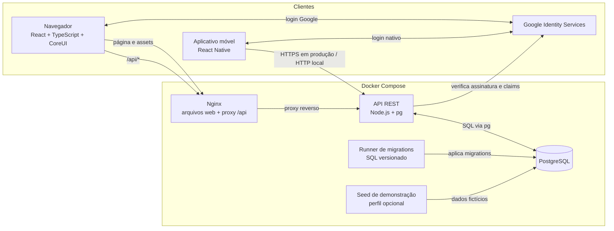
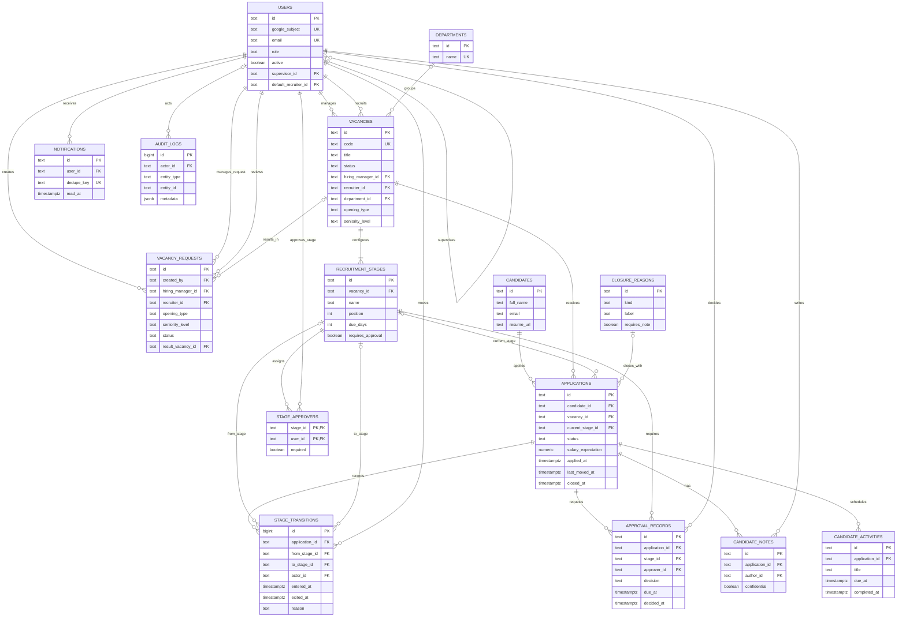
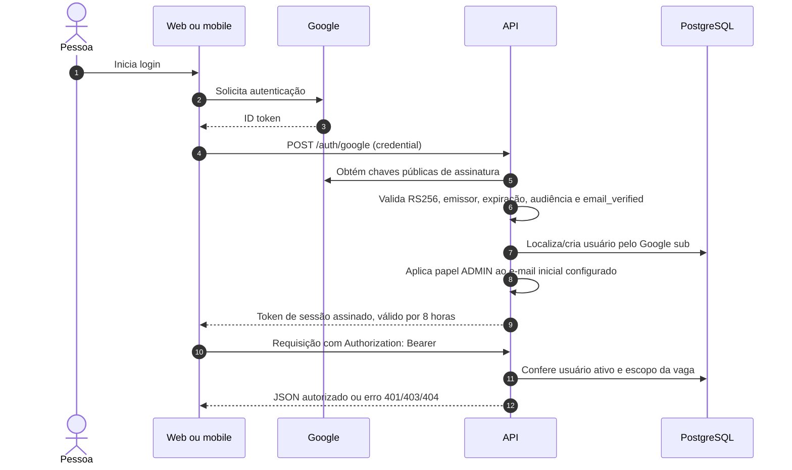
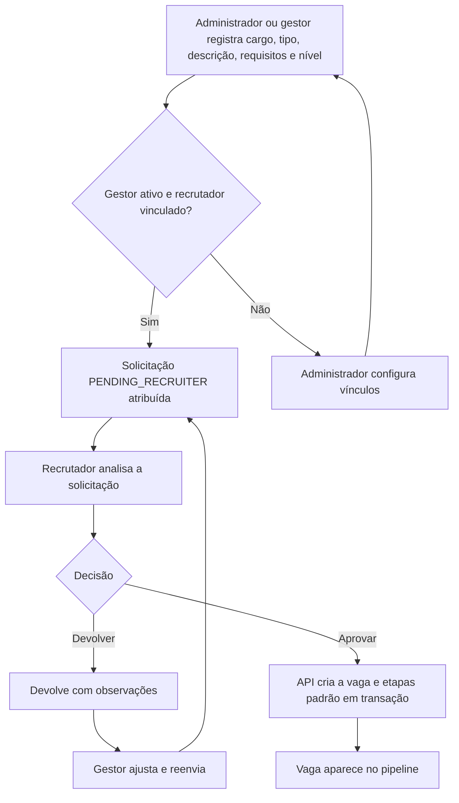

# Arquitetura do Recruitment Tracker

Este documento descreve a arquitetura executável atual e seus principais fluxos. Os diagramas usam Mermaid e podem ser renderizados pelo GitHub e por visualizadores compatíveis.

## Visão de implantação

O painel web e a API são construídos como imagens Docker separadas. O Nginx serve os arquivos do React e encaminha chamadas `/api/*` para a API. PostgreSQL é a fonte de verdade; o serviço de migração aplica os arquivos SQL antes da API iniciar. O aplicativo React Native roda no dispositivo ou simulador e acessa a mesma API.



### Componentes e limites

| Componente | Responsabilidade atual |
| --- | --- |
| `apps/web` | Interface web React/TypeScript, CoreUI, Kanban, dashboard e administração. |
| `App.tsx` (raiz) | Aplicativo React Native para Android/iOS; cliente REST em `src/api.ts`. |
| `apps/api/src/server.mjs` | API REST Node.js em monólito modular por domínio/rotas; usa `pg` e PostgreSQL. |
| `apps/api/migrations` | Schema executável do banco, aplicado em ordem pelo runner. É a fonte de verdade do banco atual. |
| `apps/web/nginx.conf` | Serve o build web e encaminha `/api/` para a API. |
| `docker-compose.yml` | Orquestra PostgreSQL, migration, API, web e seed opcional. |

O arquivo `prisma/schema.prisma` descreve um modelo de referência, mas as migrations SQL são o schema efetivamente aplicado hoje. Web e mobile compartilham a API REST e os formatos JSON; os tipos ainda não estão extraídos para um pacote compartilhado. A API está concentrada em um servidor Node.js e pode ser dividida em módulos físicos conforme o código crescer.

## Modelo relacional

`Application` representa a candidatura da pessoa a uma vaga. Dados da pessoa ficam em `candidates`; etapa, situação, salário e encerramento pertencem à candidatura. As transições registram a trilha temporal de cada candidatura.



## Autenticação e autorização



O administrador inicial é definido em `INITIAL_ADMIN_EMAIL`. Os demais usuários autenticados começam com papel limitado e o administrador gerencia papéis e vínculos. As regras de acesso são verificadas na API: administrador global; gestor para suas vagas e as do supervisor configurado; recrutador para vagas atribuídas; aprovador para vagas onde foi designado. O token de sessão é enviado como Bearer; a aplicação não usa cookie HttpOnly atualmente.

## Fluxos de negócio

### Solicitação e aprovação de abertura



O gestor configura o supervisor e o recrutador padrão na administração. A aprovação cria a vaga e suas etapas padrão; uma solicitação devolvida pode ser ajustada e submetida novamente.

### Movimentação no pipeline

```mermaid
sequenceDiagram
  autonumber
  actor Recrutador
  participant Web as Kanban web
  participant API
  participant DB as PostgreSQL

  Recrutador->>Web: Arrasta candidatura para uma etapa
  Web->>API: POST /applications/:id/move
  API->>DB: Confere papel, acesso, etapa e aprovações obrigatórias
  alt Transição válida
    API->>DB: Atualiza candidatura e fecha/abre intervalo da etapa
    API->>DB: Registra StageTransition e auditoria
    API-->>Web: Candidatura atualizada
    Web->>API: Atualiza candidatura e estatísticas da vaga
  else Regra não atendida
    API-->>Web: Erro de validação; mantém etapa atual
  end
```

## Indicadores

O endpoint `GET /dashboard/summary` aplica o escopo de acesso e aceita `vacancyId` para detalhar uma vaga. Os contadores de pipeline incluem somente candidaturas `ACTIVE`; contratações, reprovações e desistências são contabilizadas separadamente. O tempo médio até contratação considera candidaturas `HIRED` com datas de inscrição e encerramento. A conversão exibida na tela da vaga usa contratações divididas por todas as candidaturas retornadas para essa vaga.

## Estrutura e execução

```text
apps/
  api/
    src/server.mjs          # API REST e autorização
    migrations/             # migrations PostgreSQL 001–007
    scripts/                # migração e seed de demonstração
  web/
    src/App.tsx             # interface React/TypeScript
    Dockerfile
    nginx.conf
App.tsx                      # interface React Native
src/api.ts                   # cliente REST do mobile
docker-compose.yml
prisma/schema.prisma         # modelo de referência, não aplicado pelo Compose
docs/architecture.md
```

Para subir a aplicação, configure `.env` usando `.env.example` e execute:

```sh
docker compose up --build -d
```

O Compose inicia PostgreSQL, aplica migrations e sobe API e painel. O seed de demonstração é opcional via perfil `demo`. O mobile é compilado e executado no host/dispositivo, consumindo a API exposta na porta configurada.

## Limites conhecidos

- A API está implementada em JavaScript (ES modules) com validação explícita e consultas SQL via `pg`; TypeScript é usado no frontend web/mobile.
- As migrations SQL são o schema ativo; o modelo Prisma é documentação de referência e pode divergir.
- O contrato REST ainda não está centralizado em pacote compartilhado entre web e mobile.
- O login mobile usa o fluxo nativo do Google; os IDs OAuth precisam ser configurados por plataforma.
- Armazenamento privado de currículo, envio externo de notificações, retenção/eliminação automatizada LGPD e testes ponta a ponta permanecem como trabalho de evolução antes de produção.
